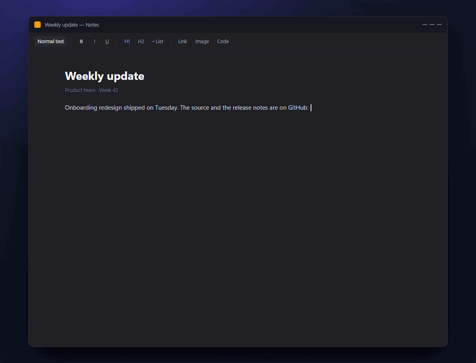
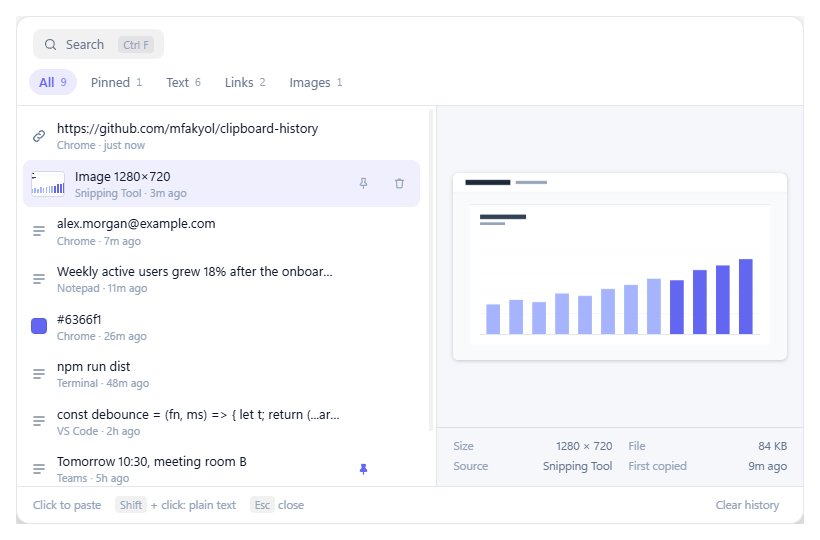
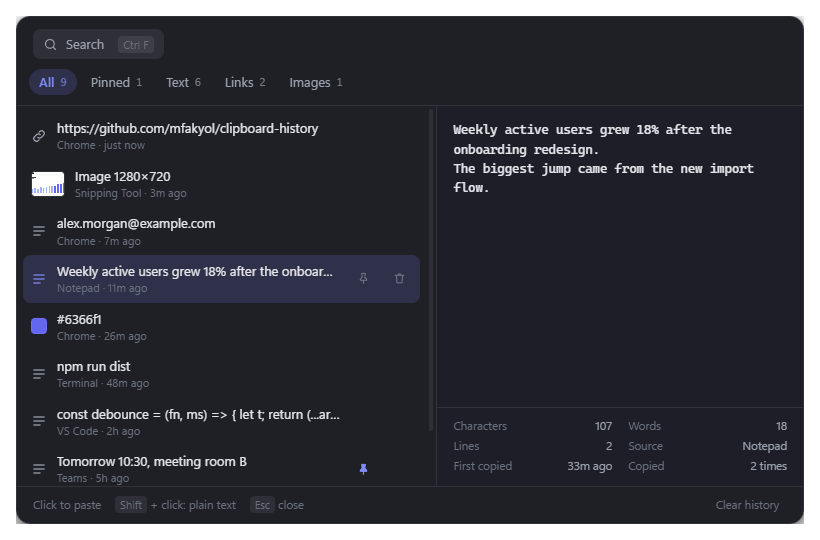

# Clipboard History

[](https://github.com/mfakyol/clipboard-history/releases/latest)
[](https://github.com/mfakyol/clipboard-history/releases/latest)
[](LICENSE)

Clipboard history for Windows and macOS. It remembers everything you copy, and `Ctrl+Shift+V` (`⌘⇧V` on macOS) opens it right under the field you're typing in, without taking focus from it. Click an item and it's pasted there.

**[⬇ Download for Windows or macOS](https://github.com/mfakyol/clipboard-history/releases/latest)**



| Light theme | Dark theme |
|---|---|
|  |  |

## Features

- **Opens where you type:** right under the focused field or the text cursor, in browsers too
- **Never steals focus:** the field you're typing in keeps its focus and caret
- **One click to paste:** `Shift`+click pastes plain text without formatting
- **Text, links, colors and images:** links show their domain, color codes a swatch, screenshots a preview
- **Search on demand:** ignores case and accents and handles Turkish letters (`sifre` finds `Şifre`)
- **Pinned items:** never removed when the history fills up, and kept in their own tab
- **Private:** copies from password managers are never saved, and nothing leaves your computer
- **Runs in the tray** (menu bar on macOS): starts at login, and recording can be paused at any time

## Tech stack

| Area | Technology |
|---|---|
| Desktop runtime | Electron 44: non-activating window (NSPanel on macOS), tray, global shortcuts |
| Interface | React 19 |
| Build | Vite 8 |
| Windows integration | PowerShell helper hosting C# (Win32, UI Automation), no native modules |
| macOS integration | Small Swift helper (Accessibility API, CGEvent, NSPasteboard), built as a universal binary |
| Packaging | electron-builder (NSIS installer, DMG) |

## Getting started

1. Download the file for your system from the [latest release](https://github.com/mfakyol/clipboard-history/releases/latest):
   - **Windows:** run `Clipboard History Setup <version>.exe`. It is unsigned, so on first run choose **More info → Run anyway** in the SmartScreen prompt.
   - **macOS:** open the `arm64` DMG on Apple Silicon or the `x64` DMG on Intel and drag the app to Applications. It is not notarized, so the first launch is blocked: open **System Settings → Privacy & Security** and choose **Open Anyway**. Then allow it under **Privacy & Security → Accessibility**; it needs this to paste and to open under the field you're typing in.
2. Copy things as usual: text, links, screenshots (`Win+Shift+S`, or `⌘⌃⇧4` on macOS).
3. Click into any text field and press `Ctrl+Shift+V` (`⌘⇧V`), then click an item to paste it.
4. In the tray (menu bar) menu turn on **Start with Windows** (**Open at login** on macOS).

## Keyboard shortcuts

| Windows | macOS | Action |
|---|---|---|
| `Ctrl+Shift+V` | `⌘⇧V` | Open the history |
| `Ctrl+Shift+V` twice | `⌘⇧V` twice | Paste the newest item |
| `Ctrl+F` | `⌘F` | Search (`↑` `↓` to select, `Enter` to paste) |
| `Esc` | `Esc` | Close |

## Settings

Pause recording, start at login and clear history are in the tray menu. The shortcut, the history size and the apps to ignore can be changed in `settings.json` (`%APPDATA%\Clipboard History\` on Windows, `~/Library/Application Support/Clipboard History/` on macOS); choose **Reload settings** in the tray menu afterwards.

## Requirements

- Windows 10 or later, 64-bit
- macOS 12 Monterey or later, Apple Silicon or Intel

## Building from source

```bash
npm install
npm run dev        # run with hot reload (builds the macOS helper first on a Mac)
npm run dist       # build the Windows installer into release/
npm run dist:mac   # build the macOS DMGs into release/ (needs Xcode command line tools)
```

Curious about the internals? See [How it works](docs/how-it-works.md).

## License

[MIT](LICENSE)

---

Made by Fatih Akyol · [fatihakyol.com](https://fatihakyol.com/)
